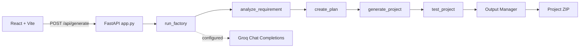

# Architecture & Integration Contracts

## High-level flow

## Module contracts

- `analyze_requirement(user_prompt) -> dict`: returns `project_name`, `requirements`, `features`, `ai_mode`.
- `create_plan(requirements) -> dict`: returns `project_name`, `features`, `tasks`, `architecture_notes`, `ai_mode`.
- `generate_project(plan) -> dict`: returns `status`, `output_path`, `project_id`, `files`.
- `test_project(build_result) -> dict`: returns `status`, `message`, `checks`, `passed`, `failed`.
- `run_factory(user_prompt) -> dict`: returns `requirements`, `plan`, `build`, `tests`, `events`.

All agent contracts are synchronous Python functions to keep integration simple. Exceptions are caught at the workflow/API boundary and represented as failed stage results.

## Trust boundaries

- The Groq key is read only by the backend from environment variables.
- User input is treated as data. The builder uses a fixed template and sanitizes generated project names.
- Generated files are written only inside `backend/outputs/`.
- Generated starter projects are not automatically executed.

## Status semantics

A stage is marked successful only after its work completes. Tester status is `passed` only when all required structural checks pass.
